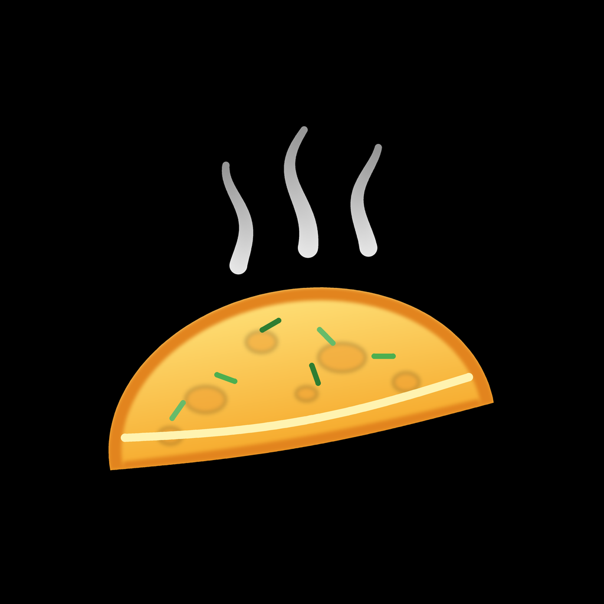

# Omelet
Альтернативный FOSS клиент для мессенджера MAX — форк [Komet](https://github.com/KometTeam/Komet) с темой в стиле HyperOS.

## Что нового по сравнению с Komet
- **Тема Miuix** — визуальный стиль по мотивам библиотеки [miuix](https://github.com/compose-miuix-ui/miuix): палитра HyperOS, сглаженные (squircle) углы, свитчи и карточки в стиле HyperOS.
- **Настройки размытия** — текстурное размытие панелей с регулировкой радиуса и шума.
- **Жидкое стекло** — стеклянные навигация, шапка чата и поле ввода: размытие стекла, блик по краю, преломление.

Включается в «Кастомизация → Тема Miuix» или «Внешний вид → Визуальный стиль → Miuix».

## Установка
[Последний релиз](https://github.com/brovium42/Omelet/releases/latest)

## Сборка из исходного кода
```console
$ flutter pub get
$ flutter build apk --release --flavor omelet
$ flutter build [windows|linux] [--release]
```

## Благодарности
Основано на [Komet](https://github.com/KometTeam/Komet) от KometTeam ([Telegram канал](https://t.me/TeamKomet)).
